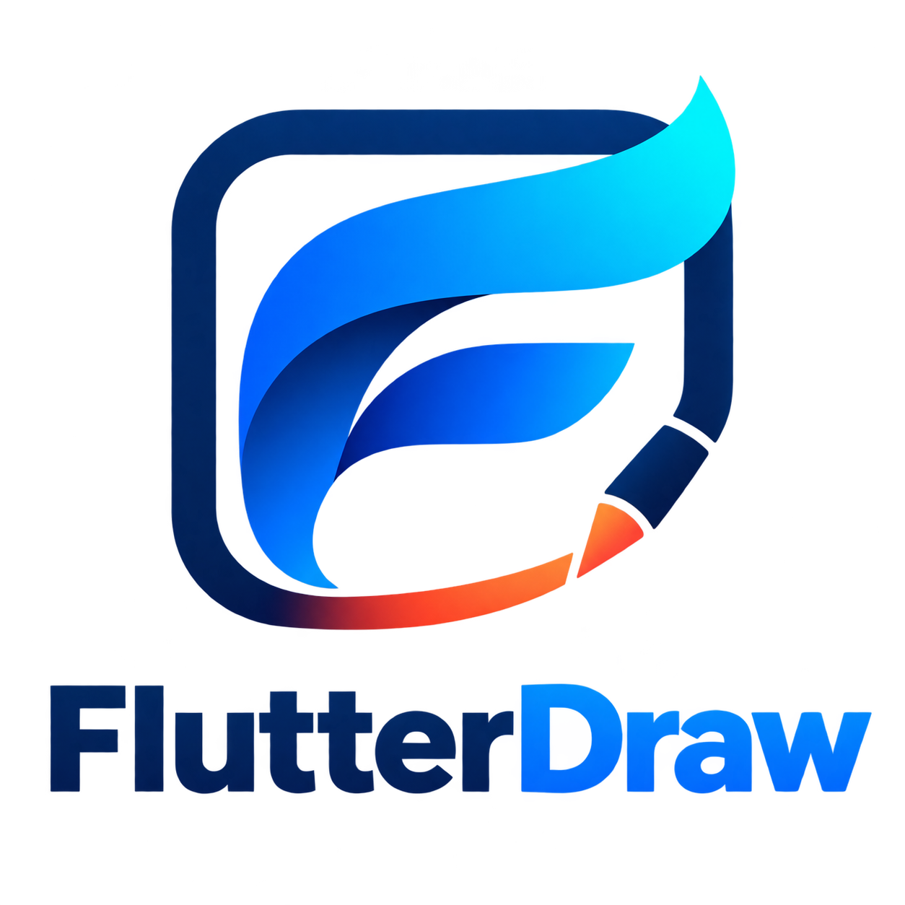
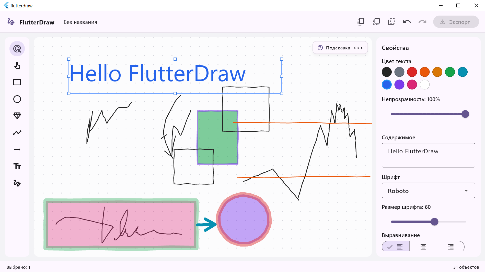

# FlutterDraw

  

FlutterDraw is a cross-platform hand-drawn whiteboard built with Flutter.

## Screenshots

## Goals

- Infinite canvas with a sketch-like visual style.
- Desktop-first experience for Windows, macOS and Linux.
- Shared core for Web, Android and iOS.
- Import and export of the Excalidraw .excalidraw document format.
- Native Flutter rendering and interaction. The Excalidraw React application is a behavioral and format reference, not an embedded runtime.

## Target platforms

Windows, macOS, Linux, Web, Android and iOS.

## Project status

FlutterDraw is under active development. The current application includes:

- Infinite canvas with adaptive grid, cursor-centered zoom and pan.
- Rectangle, ellipse, diamond, line, arrow and freehand drawing tools.
- Text elements with inline editing, font, size, alignment and color controls.
- Selection, marquee multi-selection, move, resize, copy, paste and duplicate.
- Independent stroke and fill opacity, stroke/fill styling and z-order controls.
- Right-click context menu, grouping/ungrouping and six alignment operations.
- Grid snapping, smart alignment guides and a reorderable layers panel.
- Undo/redo history with gesture grouping.
- Native `.flutterdraw` JSON documents with open, save and new-document actions.
- Excalidraw JSON import/export for supported elements, with preservation of unsupported records and metadata.
- Embedded image elements with file-picker import, canvas selection/move/resize, opacity control, and self-contained document assets.
- PNG export at 2× resolution and SVG vector export, including embedded images.
- Debounced local autosave and recovery of the last editing session.
- File menu and keyboard shortcuts for document operations.

## Keyboard shortcuts

| Shortcut | Action |
| --- | --- |
| Space + drag | Pan the canvas |
| Middle mouse + drag | Pan the canvas |
| Mouse wheel | Zoom around the pointer |
| Shift + click | Add/remove an element from selection |
| Drag on empty canvas | Marquee selection |
| Delete / Backspace | Delete selected elements |
| Escape | Cancel current gesture and clear selection |
| Ctrl/Cmd + C | Copy selected elements |
| Ctrl/Cmd + V | Paste copied elements |
| Ctrl/Cmd + D | Duplicate selected elements |
| Ctrl/Cmd + ] | Bring selection to front |
| Ctrl/Cmd + [ | Send selection to back |
| Ctrl/Cmd + Z | Undo |
| Ctrl/Cmd + Shift + Z or Ctrl/Cmd + Y | Redo |
| Ctrl/Cmd + N | New document |
| Ctrl/Cmd + Shift + S | Save document as… |
| Ctrl/Cmd + O | Open a `.flutterdraw` or Excalidraw document |
| Ctrl/Cmd + S | Save the current document (or open Save As for a new/imported document) |
| Ctrl/Cmd + G | Group selected elements |
| Ctrl/Cmd + Shift + G | Ungroup selected elements |
| Right-click | Open the canvas context menu |

## Documentation

- [Project Wiki](https://github.com/denis-aka-wolf/flutterdraw/wiki) - guides, project pages and development documentation.
- [User guide](docs/USER_GUIDE.md) - canvas tools, editing, files, autosave and keyboard shortcuts.
- [Architecture](docs/ARCHITECTURE.md) - modules, document model and implementation roadmap.
- [Local release build guide](docs/BUILDING_RELEASES.md) - build Windows, Android and Web packages without GitHub Actions.

## Architecture

See [docs/ARCHITECTURE.md](docs/ARCHITECTURE.md) for the architecture, module boundaries, document model and implementation roadmap.

## Development

Install Flutter, then run:

    flutter pub get
    flutter analyze
    flutter test
    flutter run -d windows

Use macos, linux, chrome, android or an available iOS simulator/device for other targets.

## Building release packages on Windows

GitHub Actions is not required. With Flutter, Visual Studio C++ build tools and Android SDK installed, run:

    .\scripts\build_release.ps1

The script runs analysis and tests, then creates Windows, Android APK and Web packages in dist/vX.Y.Z. See [the release build guide](docs/BUILDING_RELEASES.md) for requirements and manual GitHub Releases publishing.

## File formats and export

The native `.flutterdraw` format is FlutterDraw's editable document format. Excalidraw `.excalidraw` and JSON files can be imported and exported for supported element types. The codec maps common shapes, lines, arrows, freehand strokes, text and group membership. Unknown metadata and unsupported element records are retained where possible, including image elements with embedded file data.

PNG export renders the document bounds at 2× resolution. SVG export writes vector geometry, text and embedded image data; PNG export renders embedded images. Neither export reproduces the seeded sketch jitter pixel-for-pixel. Export commands are available from the **Файл** menu.

## License

The project license will be finalized before the first public release. Third-party code and algorithms will retain their original license notices.
